# ha-vivarium-card

[](https://www.home-assistant.io/integrations/marketplace/)
[](https://github.com/juju35/ha-vivarium-card/actions/workflows/hacs.yml)
[](https://github.com/juju35/ha-vivarium-card/actions/workflows/validate.yml)
[](https://github.com/juju35/ha-vivarium-card/actions/workflows/lint.yml)
[](https://github.com/juju35/ha-vivarium-card/releases/latest)
[](https://github.com/juju35/ha-vivarium-card/blob/main/LICENSE)
[](https://buymeacoffee.com/julienstep9)

<p align="center">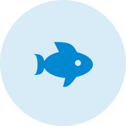</p>

<p align="center">
  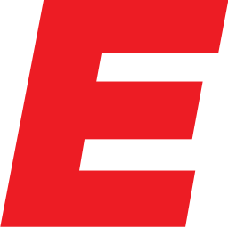&nbsp;&nbsp;
  &nbsp;&nbsp;
  &nbsp;&nbsp;
  &nbsp;&nbsp;
  &nbsp;&nbsp;
  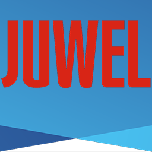&nbsp;&nbsp;
  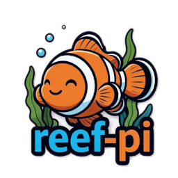&nbsp;&nbsp;
  
</p>

Lovelace cards for Home Assistant to watch over a **vivarium**: an **aquarium** (reef or freshwater), a **terrarium** (reptiles, amphibians, invertebrates) or a **turtle tank**. An animated habitat as header — clownfish in their anemone and tangs among the corals of a reef, neon tetras and discus in a planted tank, a bearded dragon under its basking lamp, dart frogs in the mist, red-eared sliders on their basking dock, and 32 themes in all — that follows your lamps (moonlight at night, the basking spot, the UVB tube), your filter, heater, CO₂, mister and feeder; the equipment as tiles; the water measures or the terrarium's climate (hot spot, cool side, humidity, UV index) as colored gauges with the ideal ranges of the animal; advice when something drifts; and buttons to feed and switch the lamps, the filter and the mister.

The cards work on top of the integrations you already use — [EHEIM Digital](https://www.home-assistant.io/integrations/eheimdigital/), [Red Sea ReefBeat](https://github.com/Elwinmage/ha-reefbeat-component), [Neptune Apex](https://github.com/itchannel/apex-ha), [Chihiros](https://github.com/TheMicDiet/chihiros-led-control), [Seneye](https://github.com/mcclown/home-assistant-custom-components), [Reef-Pi](https://github.com/tdragon/reef-pi-hass-custom), [ESPHome](https://www.home-assistant.io/integrations/esphome/)… An aquarium is often several devices (a filter, a heater, a light, a probe): pick the **area** of the tank, or its devices, and its entities are **discovered automatically** from the Home Assistant registries, whatever your language or entity ids; any entity can be set or replaced one by one (a Shelly plug for the air pump, a template sensor for the nitrate of your weekly test…).

[](https://my.home-assistant.io/redirect/marketplace_repository/?owner=juju35&repository=ha-vivarium-card&category=plugin)

| Reef | Freshwater |
|---|---|
| 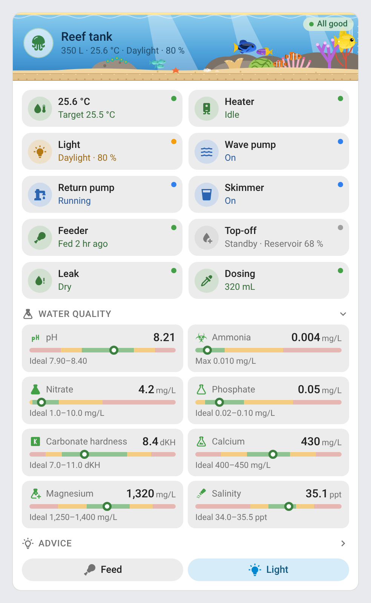 | 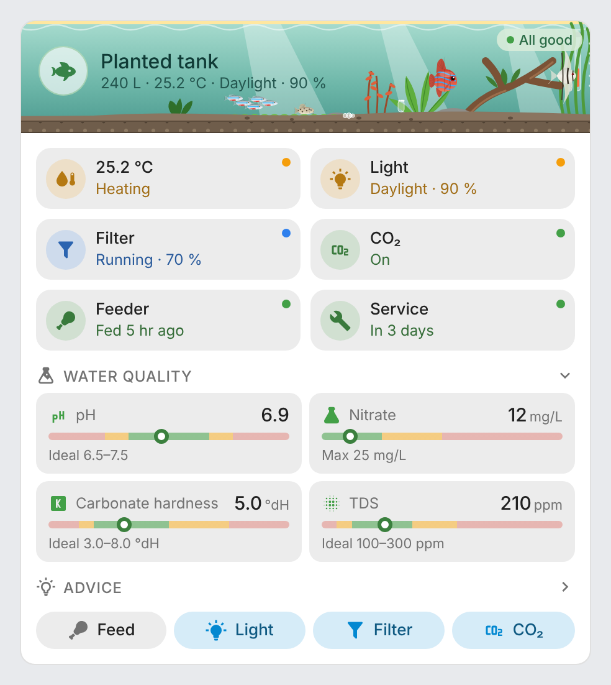 |
| 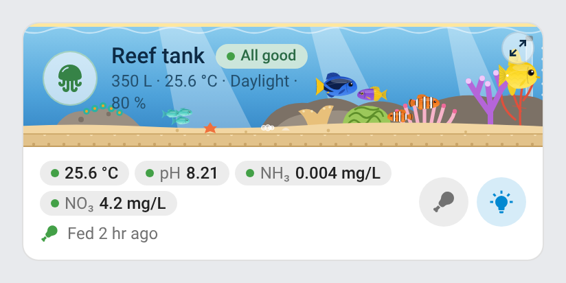 | 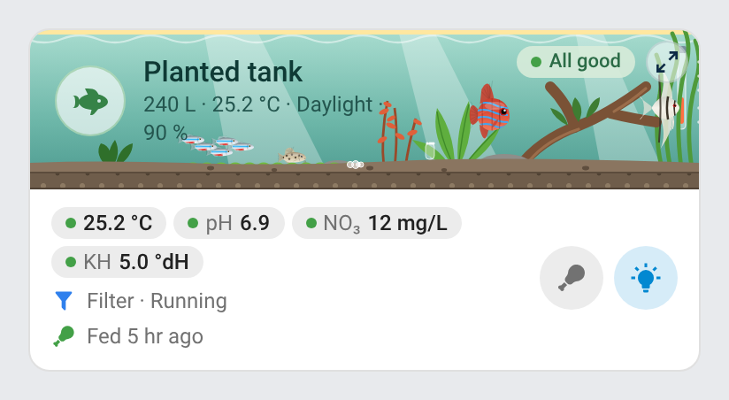 |

| Terrarium | Turtle tank |
|---|---|
| 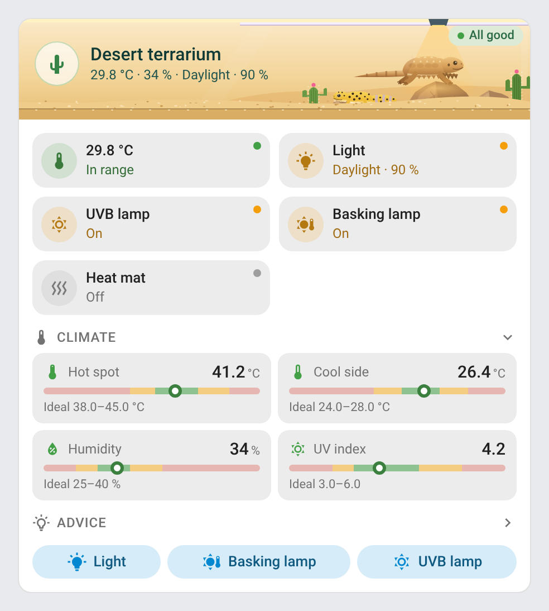 | 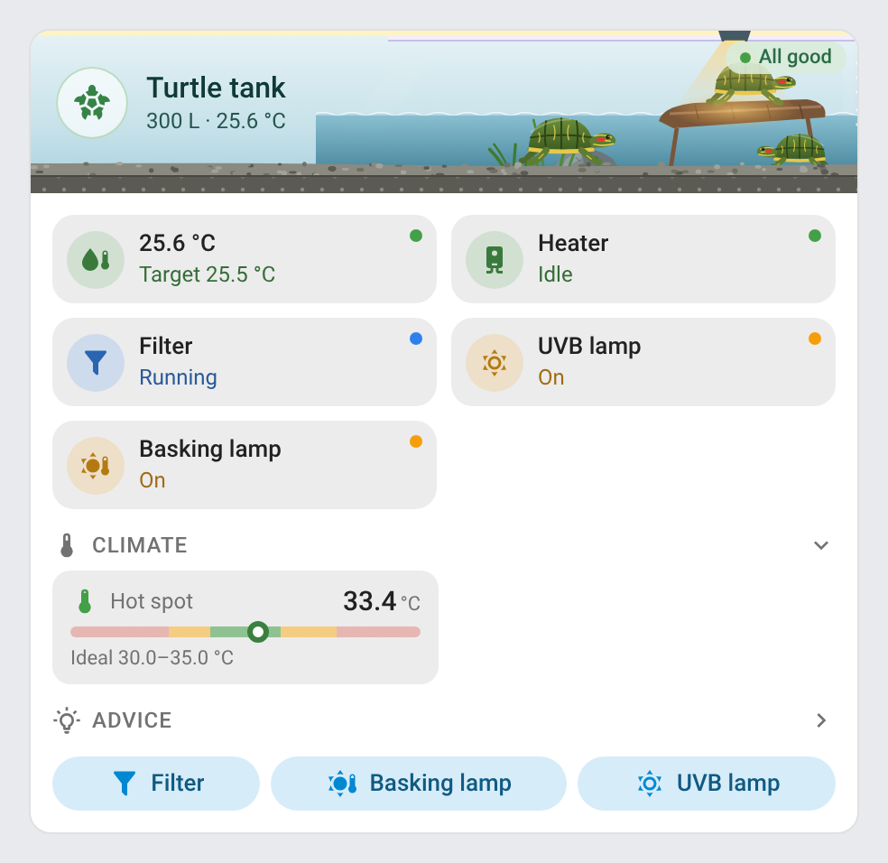 |
| 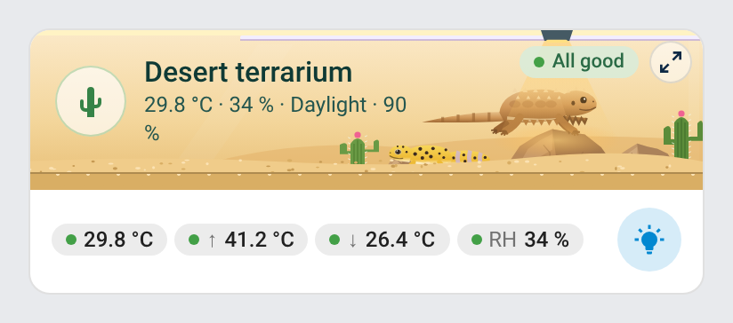 | 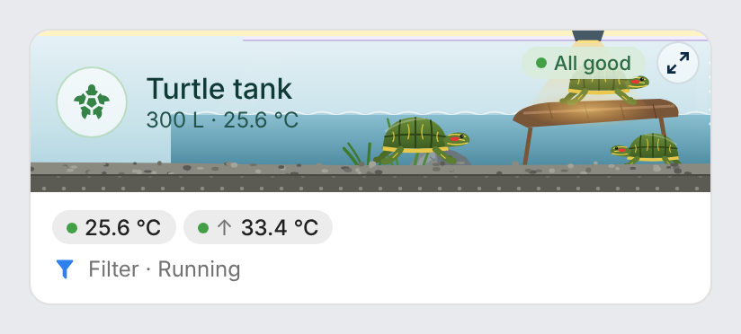 |

## Features

- Two cards: a full **Vivarium Card** (`custom:vivarium-card`) and a compact **Vivarium Mini Card** (`custom:vivarium-mini-card`), for a reef or freshwater aquarium, a terrarium or a turtle tank (`kind`, guessed from the equipment and the names)
- Illustrated header: the tank itself, 90 px high on its substrate strip, with the name, the subtitle (volume, temperature, light) and the status pill (**All good**, **Check the tank**, **Action needed**) on the water — see [Animations](#animations)
  - **Reef**: clownfish in their anemone, a blue tang, a yellow tang, a royal gramma and a school of chromis among acropora, brain, fan and leather corals, zoanthids, live rock, sand and a starfish
  - **Freshwater**: neon tetras, a discus, an angelfish and a corydoras among vallisneria, an amazon sword, red ludwigia, java fern on driftwood, anubias and moss
  - **Terrarium**: 11 habitats (`scene`) — desert with a bearded dragon, rainforest with dart frogs, leopard gecko, panther chameleon, ball python, tarantula, stick insects and mantises, crested gecko, paludarium, hermit crabs and Hermann's tortoise; the basking spot glows while its lamp is on, the UVB tube lights up, the mist drifts while the mister runs, the heat mat warms the ground
  - **Turtle tank**: red-eared sliders on their basking dock or a musk turtle, plus the axolotl's cold freshwater tank
  - The animals live: lizards, tarantula, hermit crabs and tortoises walk on alternate legs, the chameleon creeps, rolls its eye and shoots its tongue, the crested gecko climbs the glass, the python breathes and flicks its tongue, frogs hop and pulse their throat, fish beat their tail and flutter their fins
  - **18 themed aquariums** (`scene`, or chosen from the tank's name): iwagumi, Amazon blackwater, Lake Malawi, Lake Tanganyika, shrimp, betta, goldfish, brackish mangrove, garden pond, SPS reef, soft corals, nano reef, seahorses, jellyfish, predator lagoon, wreck and treasure, abyss and arctic ice — see [Scenes](#scenes)
  - It follows the tank: the light's brightness and color in the rays, **night** when the light is off and **moonlight** when it is dimmed (a reef's corals then fluoresce and pulse under the actinic blue), bubbles while the filter (or the air pump) runs and the water drifts, CO₂ bubbles from the diffuser, the heater glowing while it heats, the corals swaying faster with the wave pump, food flakes falling just after a feeding; in trouble, the fish stand still and the water clouds (green with algae when nitrate or phosphate are high)
- Equipment as tiles (round tinted icon, name, colored state and a status dot on each): water temperature with the heater's state and target, heater, light (daylight / moonlight and brightness), filter with its speed, wave pump, return pump, skimmer, CO₂, air pump, UV sterilizer, feeder (*Fed 2 hr ago*, *Feeding…*), top-off with its reservoir level, water level, leak sensor, dosing, service countdown and power
- Terrarium climate gauges with the ideal ranges of the animal: air temperature, hot spot (basking), cool side, humidity and UV index (a bearded dragon's hot spot is 38–45 °C, a dart frog's air 80–100 % humid); tiles and buttons for the basking lamp, the UVB lamp, the heat mat and the mister
- Water quality gauges with their ideal range (green), warning margins (orange) and critical zones (red): pH, ammonia, nitrite, nitrate, phosphate, carbonate hardness (KH / alkalinity), general hardness (GH), calcium, magnesium, salinity, redox (ORP), conductivity, TDS and dissolved oxygen — reef and freshwater ranges, in the unit of each sensor (°C or °F, ppt or specific gravity, dKH or meq/L, µS/cm or mS/cm), all configurable (`ranges`)
- Advice for every value out of its range (ammonia: change a quarter of the water and feed less…) and for the equipment (leak under the tank, filter or return pump stopped, top-off reservoir almost empty, water level low, service due)
- Buttons to feed (a `button`, a `script` or a switch), switch the light, the filter, the CO₂ and the air pump; stopping the filter asks for a confirmation (popup at the top of the card, **Cancel** focused)
- Collapsible sections (water quality, advice; advice folded by default, with its count), folded back by a click anywhere else on the page
- Detail button on the mini card (top right): it switches the mini card to the full card's content and back; a click anywhere outside the card brings the compact view back
- Click any tile or value to open its Home Assistant history (more-info dialog)
- Visual editor in the dashboard UI for both cards (no YAML needed)
- Light and dark mode, English, French, German, Spanish, Serbian (Cyrillic and Latin), Italian, Dutch, European Portuguese, Polish, Romanian, Danish, Swedish, Bulgarian, Russian, Ukrainian, Hungarian, Slovak, Czech, Slovenian, Latvian and Greek
- Single file, no external dependency, the tank is drawn by the card itself

## Supported integrations

The card reads standard Home Assistant entities: any integration exposing them works. Those below are the usual aquarium ones; their entities are found from the area or the devices you pick (or, with no option at all, from the integrations themselves).

| Integration | Devices | What the cards show |
|---|---|---|
|  [EHEIM Digital](https://www.home-assistant.io/integrations/eheimdigital/) (core) | classicLEDcontrol+e, thermocontrol+e, classicVARIO+e, professionel5e, reeflexUV+e | Light (brightness, moonlight), heater (`climate`: heating state, target, current temperature), filter pump (switch) and its current speed, hours until service, UV sterilizer |
|  [Red Sea ReefBeat](https://github.com/Elwinmage/ha-reefbeat-component) (custom) | ReefLED, ReefWave, ReefRun, ReefATO+, ReefDose, ReefMat | Light, wave pump, return pump and skimmer, top-off with its reservoir level and leak sensor, dosing (remaining volume) |
|  [Neptune Apex](https://github.com/itchannel/apex-ha) (custom) ·  [Apex Fusion (Local)](https://github.com/roblandry/apex-fusion-home-assistant) (custom) | Apex controllers and their probes | Probes (temperature, pH, ORP, salinity, conductivity, Trident alkalinity, calcium and magnesium) and outlets as switches (heater, return pump, skimmer, light… recognized from their names) |
| Seneye — [custom component](https://github.com/mcclown/home-assistant-custom-components) or an [MQTT bridge](https://github.com/tamengual/seneye-mqtt-rpi) | Seneye Home, Pond, Reef | Temperature, pH, free ammonia (NH₃) |
|  [Chihiros](https://github.com/TheMicDiet/chihiros-led-control) (custom) · [AquaBle](https://github.com/caleb-venner/AquaBle) (custom) | Chihiros WRGB / A II / C II LEDs, dosing pumps | Light (brightness, color in the rays), dosing |
|  [Juwel HeliaLux](https://github.com/MrSleeps/Juwel-HeliaLux-Home-Assistant-Custom-Component) (custom) | HeliaLux SmartControl | Light |
| Mobius — [ha-mobius](https://github.com/r3pek/ha-mobius) (custom) | EcoTech Radion and VorTech, AquaIllumination, NYOS | Light, wave pumps |
|  [Reef-Pi](https://github.com/tdragon/reef-pi-hass-custom) (custom) | Reef-Pi controllers | Temperature, pH, equipment switches, top-off |
|  [ESPHome](https://www.home-assistant.io/integrations/esphome/) (core) | DIY probes and controllers (DFRobot, Atlas Scientific…), feeders, float switches, dosing pumps | Any sensor, switch, button and binary sensor, recognized from their names (`ph`, `nitrate`, `tds`, `co2`, `feeder`, `ato`, `leak`…) |
| Terrarium equipment | Herpstat / Spyder Robotics, Habistat, Microclimate or ESPHome thermostats and probes, Exo Terra / Lucky Reptile misters, basking and UVB lamps on smart plugs (Zigbee, Shelly, Tuya…) | Air, hot spot and cool side temperatures, humidity, UV index; basking lamp, UVB lamp, heat mat and mister as tiles and buttons |
| Any other | Shelly / Sonoff / Tuya plugs, template sensors, helpers | Set each entity in the options: light, heater, filter, pumps, CO₂, feeder, sensors |

How the card recognizes each entity is detailed in [How it works](#how-it-works).

## Prerequisites

Home Assistant 2024.8 or later, with the aquarium's devices available as entities (see [Supported integrations](#supported-integrations)). Putting the aquarium's devices in an area of their own (*Reef tank*, *Aquarium*…) makes the setup a single option.

## Installation

### Via the Marketplace (recommended)

Click the button below to add the repository directly:

[](https://my.home-assistant.io/redirect/marketplace_repository/?owner=juju35&repository=ha-vivarium-card&category=plugin)

Then click **Install**, and reload your browser when the Marketplace asks you to.

Or manually:

1. Open **Settings → Marketplace → Add from link** (top right; this needs a GitHub account connected)
2. Add `https://github.com/juju35/ha-vivarium-card` — Type: **Dashboard**
3. Open **Vivarium Card** and click **Install**
4. Clear your browser cache and refresh

The Marketplace adds the resource `/local/community/ha-vivarium-card/vivarium-card.js` for you.

### Manual

1. Download `vivarium-card.js` and the `vivarium-card.i18n.*.js` translation files from the [latest release](https://github.com/juju35/ha-vivarium-card/releases/latest)
2. Copy them all to `/config/www/` (without the translation files, the cards show in English)
3. Go to **Settings → Dashboards → ⋮ → Resources** → Add resource:
   - URL: `/local/vivarium-card.js`
   - Type: **JavaScript Module**
4. Clear your browser cache and refresh

## Configuration

### Card types

| Card | Type |
|---|---|
| Vivarium Card | `custom:vivarium-card` |
| Vivarium Mini Card | `custom:vivarium-mini-card` |

### Visual editor

Edit a dashboard, click **Add card** and search for **Vivarium Card** or **Vivarium Mini Card**. Pick the area of the tank (or one of its devices), set the entities the card did not find under **Entities**, the kind of tank and its volume, the ideal ranges, the sections, the illustration theme and the language. The preview updates live, and options left at their default are kept out of the generated YAML.

### Minimal

```yaml
type: custom:vivarium-card
area: Reef tank
```

```yaml
type: custom:vivarium-mini-card
area: Reef tank
```

Without any option, the card gathers the entities of the aquarium integrations (EHEIM Digital, Red Sea, Apex, Chihiros, Seneye, Reef-Pi…) and of the devices of aquarium brands or named *aquarium*, *reef* or *tank*: with one tank, that is all it needs.

### Full options

```yaml
type: custom:vivarium-card
area: Living room tank
devices:
  - classicVARIO+e
  - thermocontrol+e
title: Planted tank
kind: freshwater
volume: 240
# Entities: each one replaces what was discovered (or completes it)
water_temperature: sensor.tank_temperature
ph: sensor.tank_ph
ammonia: sensor.tank_nh3
nitrite: sensor.tank_no2
nitrate: sensor.tank_no3
phosphate: sensor.tank_po4
kh: sensor.tank_kh
gh: sensor.tank_gh
calcium: sensor.reef_calcium
magnesium: sensor.reef_magnesium
salinity: sensor.reef_salinity
orp: sensor.tank_orp
conductivity: sensor.tank_conductivity
tds: sensor.tank_tds
oxygen: sensor.tank_oxygen
light: light.tank_led
heater: climate.tank_heater
filter: switch.tank_filter
filter_speed: sensor.tank_filter_speed
wave_pump: switch.wave_pump
return_pump: switch.return_pump
skimmer: switch.skimmer
co2: switch.co2_solenoid
air_pump: switch.air_pump
uv: switch.uv_sterilizer
feeder: button.tank_feeder_feed
ato: switch.top_off_pump
reservoir: sensor.top_off_reservoir_level
water_level: binary_sensor.sump_float_low
leak: binary_sensor.cabinet_leak
dosing: sensor.doser_remaining_volume
service: sensor.filter_hours_until_service
power: sensor.tank_power
# Terrarium and turtle tank
air_temperature: sensor.terrarium_air_temperature
hot_spot: sensor.terrarium_hot_spot
cold_spot: sensor.terrarium_cool_side
humidity: sensor.terrarium_humidity
uv_index: sensor.terrarium_uv_index
basking: switch.basking_lamp
heat_mat: switch.heat_mat
mister: switch.mister
invert_level: false
ranges:
  water_temperature_min: 25
  water_temperature_max: 27
  ph_min: 6.6
  ph_max: 7.2
  nitrate_max: 20
show_title: true
show_subtitle: true
illustration: true
scene: auto
illustration_theme: auto
show_equipment: true
show_quality: true
show_advice: true
show_controls: true
collapsed:
  - advice
language: fr
```

```yaml
type: custom:vivarium-mini-card
area: Reef tank
volume: 350
zoom: true
```

### Options reference

| Option | Card | Default | Description |
|---|---|---|---|
| `area` | both | — | Area of the aquarium (its name, or its area id, set by the visual editor): every entity of its devices is considered |
| `device` / `devices` | both | — | A device of the aquarium, or a list of them (`devices`, YAML only), by name or device id; with `area` too, both are gathered |
| `title` | both | Area or device name | Card title |
| `kind` | both | `auto` | `reef`, `freshwater`, `terrarium`, `turtle` or `auto`: the scene chosen, else a reef when there is a salinity, calcium or magnesium sensor, a skimmer or a return pump; else an animal or theme named by the title, the area or the devices; else a terrarium when there is a basking lamp, a heat mat, a mister, hot or cool side probes, a UV index or a humidity sensor (a turtle tank when there is also a filter or water measures); else the reef, terrarium or freshwater brands of the names. It gives the scene, the icon, the measures shown and their ideal ranges |
| `volume` | both | — | Volume of the tank in liters, shown in the subtitle |
| `water_temperature` | both | Discovered | Water temperature sensor (else the heater's current temperature) |
| `ph`, `ammonia`, `nitrite`, `nitrate`, `phosphate`, `kh`, `gh`, `calcium`, `magnesium`, `salinity`, `orp`, `conductivity`, `tds`, `oxygen` | both | Discovered | Water quality sensors (`kh` in °dH / dKH or meq/L, `salinity` in ppt or specific gravity, `conductivity` in µS/cm or mS/cm) |
| `light` | both | Discovered | Light (`light`, `switch` or `input_boolean`): tile, button, rays in the tank in its color and brightness; off is night in the tank, dimmed to 15 % or less (or an effect / preset named *moon*, *night*, *actinic*) is moonlight |
| `heater` | both | Discovered | Heater: `climate` (heating state, target, current temperature), `water_heater`, `switch` or `input_boolean` |
| `filter` | both | Discovered | Filter (`switch`, `fan` or `input_boolean`): tile, button (stopping asks first), bubbles and drift in the tank |
| `filter_speed` | both | Discovered | Filter speed or flow (a `sensor` or `number`), shown on the filter's tile |
| `wave_pump`, `return_pump`, `skimmer`, `co2`, `air_pump`, `uv` | both | Discovered | Pumps and devices that are on or off (`switch`, `fan`, `valve` for CO₂, `input_boolean`); a stopped return pump is a warning |
| `feeder` | both | Discovered | Feeder: a `button` (its state is the time of the last press), a `script`, a `switch` / `input_boolean`, or a timestamp `sensor` of the last meal (state only). Feed button, *Fed 2 hr ago*, and flakes falling for 3 minutes after a feeding |
| `ato`, `reservoir` | both | Discovered | Top-off pump (`switch` or `binary_sensor`) and its reservoir level (a `sensor` in % or L); under 15 % is a warning |
| `water_level` | both | Discovered | Water level: a `binary_sensor` (float switch) or a `sensor` (%, distance) |
| `invert_level` | both | `false` | For a float switch `binary_sensor`: `on` is read as *water low* when its device class is `problem` / `safety` or its name says *low*, else as *level OK*; `invert_level` turns it round |
| `leak` | both | Discovered | Leak sensor (`binary_sensor`, device class `moisture`): a leak is critical |
| `dosing` | both | Discovered | Dosing pump state or remaining volume |
| `service` | both | Discovered | Time until a service (a `sensor` in h, d, min or s, or a timestamp): *In 3 days*, a warning when due |
| `power` | both | Discovered | Power of the tank (a `sensor` in W or kW) |
| `ranges` | both | See below | Ideal ranges: `<measure>_min` and `<measure>_max` for each water measure, in the unit of the sensor |
| `show_title` | both | `true` | Show the title in the header |
| `show_subtitle` | both | `true` | Show the subtitle (volume, temperature, light) |
| `illustration` | both | `true` | The animated tank as header; `false` gives a classic header (round icon, title, status pill) |
| `scene` | both | `auto` | The habitat drawn in the header: `reef`, `planted`, an aquarium theme — `iwagumi`, `blackwater`, `malawi`, `tanganyika`, `shrimp`, `betta`, `goldfish`, `mangrove`, `pond`, `axolotl` (freshwater), `sps`, `soft_coral`, `nano_reef`, `seahorse`, `jellyfish`, `predator`, `wreck`, `abyss`, `arctic` (reef) — a terrarium — `desert`, `rainforest`, `leopard_gecko`, `chameleon`, `ball_python`, `tarantula`, `insects`, `crested_gecko`, `paludarium`, `hermit_crab`, `tortoise` — or a turtle tank — `turtle`, `musk_turtle`. With `auto`, the animal or theme named by the title, the area or the devices (*Ball python*, *Mygale*, *Dart frogs*, *Shrimp tank*, *Koi pond*…), else the reef, the planted tank, the turtle tank, or a desert or a rainforest after the terrarium's humidity. The scene also sets the animal's ideal ranges. See [Scenes](#scenes) |
| `illustration_theme` | both | `auto` | `day`, `night` or `auto`: the light of the tank (off: night, dimmed: moonlight), else the sun below the horizon or the dark theme when the tank has no light entity |
| `show_equipment` | both | `true` | Equipment tiles |
| `show_quality` | both | `true` | Water quality section |
| `show_advice` | both | `true` | Advice section |
| `show_controls` | both | `true` | Buttons (feed, light, filter, CO₂, air pump; feed and light on the mini card) |
| `collapsed` | both | `[advice]` | Sections folded by default, among `quality` and `advice` (`[]` to unfold everything). Click a section title (or Tab to it and press Enter or Space) to fold or unfold it |
| `zoom` | mini | `true` | Detail button at the top right of the mini card: it shows the full card's content (with the same options, so `show_equipment`, `show_quality`, `show_advice` and `collapsed` can be set on the mini card too, in YAML or in its visual editor) and switches back; a click outside the card also brings the compact view back. `false` removes the button |
| `language` | both | Auto | Force language: `fr`, `en`, `de`, `es`, `sr`, `sr-Latn`, `it`, `nl`, `pt`, `pl`, `ro`, `da`, `sv`, `bg`, `ru`, `uk`, `hu`, `sk`, `cs`, `sl`, `lv` or `el` (auto-detects from HA settings) |

`devices` (a list) is YAML only; the ideal ranges have their own **Ideal ranges** panel in the visual editor.

### Default ideal ranges

| Measure | Freshwater | Reef |
|---|---|---|
| Water temperature | 24–27 °C | 25–26.5 °C |
| pH | 6.5–7.5 | 7.9–8.4 |
| Ammonia (free NH₃) | 0.02 mg/L at most | 0.01 mg/L at most |
| Nitrite | 0.1 mg/L at most | 0.05 mg/L at most |
| Nitrate | 25 mg/L at most | 1–10 mg/L |
| Phosphate | 0.5 mg/L at most | 0.02–0.1 mg/L |
| Carbonate hardness (KH / alkalinity) | 3–8 °dH | 7–11 dKH |
| General hardness (GH) | 4–12 °dH | — |
| Calcium | 20–80 mg/L | 400–450 mg/L |
| Magnesium | 5–30 mg/L | 1250–1400 mg/L |
| Salinity | — | 34–35.5 ppt (SG 1.024–1.0265) |
| Redox (ORP) | 200–350 mV | 300–450 mV |
| Conductivity | 150–600 µS/cm | 51.5–54 mS/cm |
| TDS | 100–300 ppm | 5 ppm at most (osmosis water) |
| Dissolved oxygen | 6–9 mg/L | 6–8 mg/L |

These are the usual values for a tropical community tank and a mixed reef. Each measure has a warning margin around its ideal range, critical beyond. Species differ (a soft-water tank, African cichlids, a SPS reef…): set your own ideal ranges with `ranges` (or **Ideal ranges** in the visual editor). Temperatures in °F, alkalinity in meq/L, salinity as a specific gravity and conductivity in either unit are converted.

### Terrarium and turtle ranges

A terrarium's gauges follow its animal (its `scene`), a turtle tank's water follows the species:

| Scene | Air | Hot spot | Cool side | Humidity | UV index |
|---|---|---|---|---|---|
| Desert (bearded dragon) | 26–32 °C | 38–45 °C | 24–28 °C | 25–40 % | 3–6 |
| Rainforest (dart frogs) | 22–26 °C | 24–28 °C | 20–23 °C | 80–100 % | 0.5–2 |
| Leopard gecko | 24–29 °C | 30–34 °C | 22–26 °C | 30–40 % | 0.5–2 |
| Panther chameleon | 24–28 °C | 30–35 °C | 20–24 °C | 50–80 % | 1.5–3.5 |
| Ball python | 26–30 °C | 31–33 °C | 24–27 °C | 55–70 % | 2 at most |
| Tarantula | 22–27 °C | 25–29 °C | 21–25 °C | 60–75 % | 0.5 at most |
| Stick insects and mantises | 20–26 °C | 24–28 °C | 18–23 °C | 50–70 % | 2 at most |
| Crested gecko | 22–26 °C | 26–28 °C | 20–23 °C | 60–80 % | 2 at most |
| Paludarium | 22–27 °C (water 22–26 °C) | 26–30 °C | 20–24 °C | 70–90 % | 2 at most |
| Hermit crabs | 24–29 °C (water 24–28 °C) | 27–31 °C | 23–27 °C | 70–80 % | 2 at most |
| Hermann's tortoise | 22–30 °C | 32–38 °C | 18–24 °C | 50–70 % | 2–5 |
| Red-eared sliders | 25–30 °C (water 24–27 °C) | 30–35 °C | — | 50–80 % | 2–4 |
| Musk turtle | water 22–26 °C | 28–32 °C | — | 50–80 % | 2–4 |
| Axolotl | water 14–20 °C | — | — | — | — |

Usual keeping guidelines; every bound can be set in `ranges` (`hot_spot_min`, `humidity_max`…) for your own animal.

## Screenshots

### Animations

The tank lives with your aquarium: every state plays its own animation (each one loops in 8 seconds), and every one of them honours `prefers-reduced-motion`.

Reef in daylight: the fish swim, the clownfish nestle in their anemone, the wave pump sways the corals, bubbles rise and the water drifts while the return pump runs:

| Light | Dark |
|---|---|
| 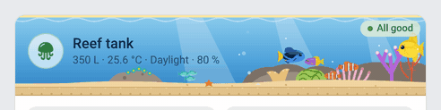 | 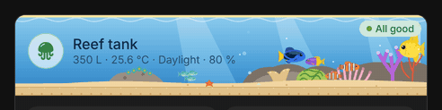 |

Reef at night, the light dimmed to its moonlight: the corals fluoresce and pulse under the actinic blue, under the moon:

| Dark | Light |
|---|---|
| 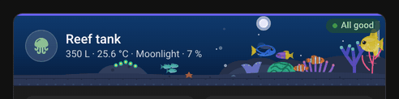 | 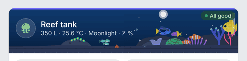 |

Just fed: food flakes fall through the water for 3 minutes:

| Light | Dark |
|---|---|
| 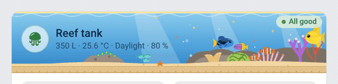 |  |

A reef in trouble (too warm, return pump stopped, nitrate high): the fish stand still, the water clouds and nothing flows:

| Light | Dark |
|---|---|
| 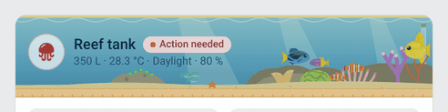 | 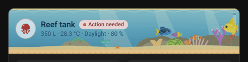 |

Planted freshwater tank: neon tetras, a discus and an angelfish among the plants, the heater glows while it heats and CO₂ bubbles rise from the diffuser:

| Dark | Light |
|---|---|
| 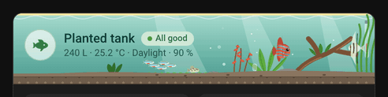 | 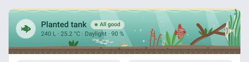 |

The planted tank with its lights off: night in the tank, the filter still running:

| Dark | Light |
|---|---|
| 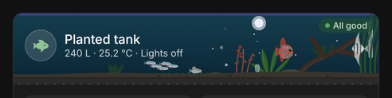 | 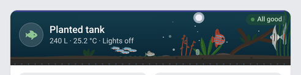 |

The planted tank just fed: the flakes fall among the plants:

| Dark | Light |
|---|---|
| 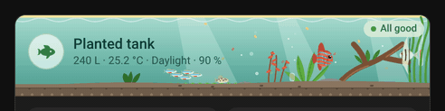 | 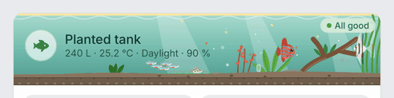 |

A planted tank in trouble (filter stopped, nitrate high): the water greens with algae, the fish stand still and nothing flows:

| Dark | Light |
|---|---|
| 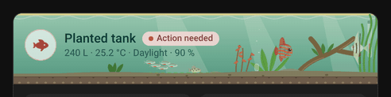 | 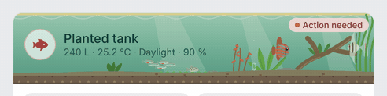 |

### Scenes

Beyond the reef and the planted tank, the header can show 18 themed aquariums, 11 terrariums and 3 turtle and axolotl tanks (`scene`). With `scene: auto` (the default) a theme is chosen when the title, the area or the devices name it, in any of the card's languages (*Shrimp tank*, *Bac à crevettes*, *Malawi*, *Hippocampes*, *Koi pond*…), among the themes of the tank's kind; else the reef or the planted tank. A scene set in the options also gives the kind of tank (and so its ideal ranges) unless `kind` is set. Every scene follows the light (night, moonlight), the heater, the filter, the CO₂ and the feeder as the reef and the planted tank do.

**Iwagumi** (`scene: iwagumi`, freshwater): Seiryu stones in a carpet of grass, a school of rasboras.

| Light | Dark |
|---|---|
| 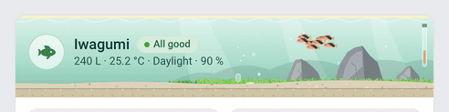 | 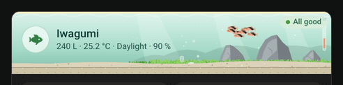 |

**Amazon blackwater** (`scene: blackwater`, freshwater): amber water, roots and dead leaves, cardinal tetras and an apistogramma.

| Light | Dark |
|---|---|
| 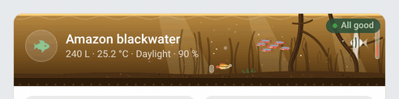 | 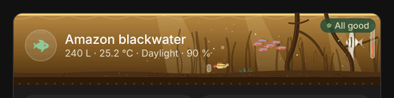 |

**Lake Malawi** (`scene: malawi`, freshwater): stacked rocks on white sand, blue, yellow and orange cichlids.

| Light | Dark |
|---|---|
| 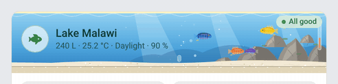 | 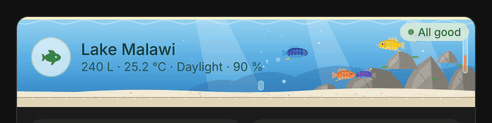 |

**Lake Tanganyika** (`scene: tanganyika`, freshwater): shell beds, shell dwellers and long-finned cichlids.

| Light | Dark |
|---|---|
| 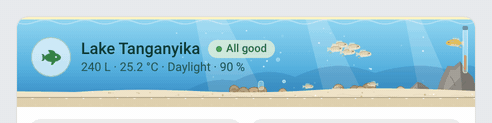 | 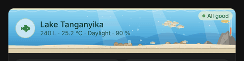 |

**Shrimp tank** (`scene: shrimp`, freshwater): cholla wood and mosses, red and blue shrimp, snails.

| Light | Dark |
|---|---|
| 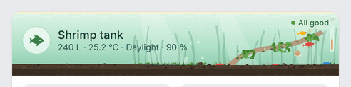 | 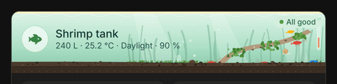 |

**Betta tank** (`scene: betta`, freshwater): a long-finned betta, floating leaves and catappa leaves.

| Light | Dark |
|---|---|
| 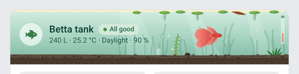 | 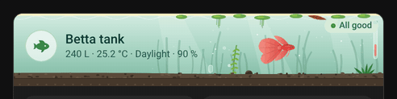 |

**Goldfish** (`scene: goldfish`, freshwater): coloured gravel, an air stone, a castle and fancy goldfish.

| Light | Dark |
|---|---|
| 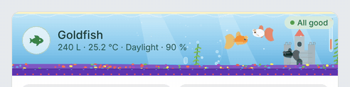 | 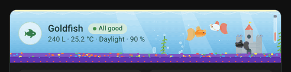 |

**Brackish mangrove** (`scene: mangrove`, freshwater): mangrove roots, archerfish and a mudskipper.

| Light | Dark |
|---|---|
| 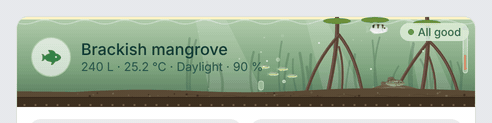 | 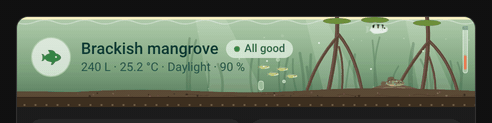 |

**Garden pond** (`scene: pond`, freshwater): seen from above: koi, water lilies and pebbles (no heater nor bubbles).

| Light | Dark |
|---|---|
| 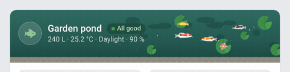 | 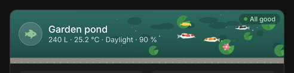 |

**SPS reef** (`scene: sps`, reef): colourful acropora, table corals, montipora, anthias and a wrasse.

| Light | Dark |
|---|---|
| 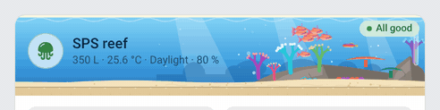 | 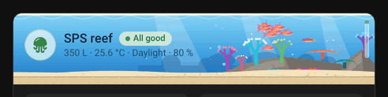 |

**Soft corals** (`scene: soft_coral`, reef): pulsing xenia, a leather coral, mushrooms and zoanthids.

| Light | Dark |
|---|---|
| 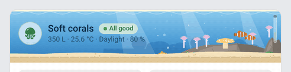 | 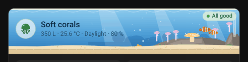 |

**Nano reef** (`scene: nano_reef`, reef): a pair of clownfish, a cleaner shrimp, a goby and a frogspawn coral.

| Light | Dark |
|---|---|
| 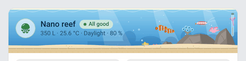 |  |

**Seahorses** (`scene: seahorse`, reef): waving seagrass, gorgonians and seahorses holding on.

| Light | Dark |
|---|---|
|  |  |

**Jellyfish** (`scene: jellyfish`, reef): dark blue water, moon and golden jellyfish pulsing.

| Light | Dark |
|---|---|
|  |  |

**Predator lagoon** (`scene: predator`, reef): a moray in its cave, a lionfish and a blue-spotted ray.

| Light | Dark |
|---|---|
|  |  |

**Wreck and treasure** (`scene: wreck`, reef): a sunken galleon, a glowing treasure chest, tropical fish.

| Light | Dark |
|---|---|
|  |  |

**Abyss** (`scene: abyss`, reef): black water, an anglerfish and its lure, lanternfish, marine snow.

| Light | Dark |
|---|---|
|  |  |

**Arctic ice** (`scene: arctic`, reef): ice at the surface, a diving seal, polar cod and a jellyfish.

| Light | Dark |
|---|---|
|  |  |

#### Terrariums and turtle tanks

The basking spot shines while the basking lamp is on (in daytime when there is none), the UVB tube lights with its lamp, the mist drifts while the mister runs, the heat mat warms the ground strip; at night the lamps go out under the moon.

**Bearded dragon** (`scene: desert`): a desert with rocks and cacti, the bearded dragon nodding under its basking spot, a leopard gecko walking.

| Light | Dark |
|---|---|
|  |  |

**Dart frogs** (`scene: rainforest`): bromeliads, a waterfall and the mist, three dart frogs hopping.

| Light | Dark |
|---|---|
|  |  |

**Leopard gecko** (`scene: leopard_gecko`): slate and a hide under the basking spot, leopard geckos walking.

| Light | Dark |
|---|---|
|  |  |

**Panther chameleon** (`scene: chameleon`): branches and a dripper, the chameleon creeping, rolling its eye and changing colour.

| Light | Dark |
|---|---|
|  |  |

**Ball python** (`scene: ball_python`): bark, a hide and a water bowl, the python coiled, breathing and flicking its tongue.

| Light | Dark |
|---|---|
|  |  |

**Tarantula** (`scene: tarantula`): coco fibre and cork bark, a red-knee tarantula walking out of its web.

| Light | Dark |
|---|---|
|  |  |

**Stick insects and mantises** (`scene: insects`): brambles and leaves, a stick insect and a mantis rocking.

| Light | Dark |
|---|---|
|  |  |

**Crested gecko** (`scene: crested_gecko`): cork tubes and vines in the mist, a gecko climbing the glass.

| Light | Dark |
|---|---|
|  |  |

**Paludarium** (`scene: paludarium`): half water half land: a planted bank, a waterfall, a tree frog and tetras.

| Light | Dark |
|---|---|
|  |  |

**Hermit crabs** (`scene: hermit_crab`): sand, spare shells, a coconut hide, fresh and salt water bowls, crabs walking.

| Light | Dark |
|---|---|
|  |  |

**Hermann's tortoise** (`scene: tortoise`): soil, hay and dandelions under the basking spot, the tortoise walking.

| Light | Dark |
|---|---|
|  |  |

**Axolotls** (`scene: axolotl`): cool water, fine sand and plants, a pink and a golden axolotl swimming.

| Light | Dark |
|---|---|
|  |  |

**Red-eared sliders** (`scene: turtle`): the water under the UVB lamp, a slider basking on its dock, two swimming.

| Light | Dark |
|---|---|
|  |  |

**Musk turtle** (`scene: musk_turtle`): shallow water, leaves and roots, musk turtles walking on the bottom.

| Light | Dark |
|---|---|
|  |  |

### Reef

Reef tank found from its area: Red Sea ReefLED, ReefWave, ReefRun and ReefATO+, a Seneye probe, a Neptune Apex with its Trident, an EHEIM heater and an ESPHome feeder:

| Light | Dark |
|---|---|
|  |  |
|  |  |

Mini card zoomed in with its detail button (top right, click it again or anywhere outside the card to go back):

| Light | Dark |
|---|---|
|  |  |

At night, the light dimmed to its moonlight (water quality and advice folded):

| Dark | Light |
|---|---|
|  |  |

A tank that needs care: too warm, the return pump stopped and the nitrate climbing — advice unfolded:

| Light | Dark |
|---|---|
|  |  |

### Freshwater

Planted tank set by its devices: EHEIM classicVARIO+e filter, classicLEDcontrol+e light and thermocontrol+e heater, an ESPHome probe with its CO₂ and feeder:

| | Card | Mini card |
|---|---|---|
| Dark |  |  |
| Light |  |  |

Stopping the filter asks first, in a popup at the top of the card:

| Light | Dark |
|---|---|
|  |  |

Narrow cards on a phone: the full card at 6 of 12 columns of a Sections view (238 px), the tiles and gauges in one column, and the mini card at 170 px; the tank keeps its water and light for the texts:

| Light | Dark |
|---|---|
|   |   |

### Terrarium

A desert terrarium found from its area: an ESPHome thermostat probe (air, hot spot, cool side, humidity, UV index), the basking lamp, the UVB lamp and the heat mat on Zigbee plugs:

| Light | Dark |
|---|---|
|  |  |
|  |  |

### Turtle tank

Water temperature and the basking spot's, the EHEIM filter and heater, the basking and UVB lamps:

| Dark | Light |
|---|---|
|  |  |
|  |  |

## How it works

The card gathers the entities of the `area` (those of its devices and those set in it directly) and of the `device` / `devices`; with no option at all, those of the aquarium integrations (EHEIM Digital, Red Sea, Apex, Chihiros, AquaBle, Mobius, Seneye, Reef-Pi, Aquatlantis, Juwel…) and of the devices whose name, brand or model says aquarium, reef or tank. It gives each one a role from its domain, device class, unit and names (entity id, translation key, names; English, French, German, Spanish, Italian and Dutch words):

| Role | Recognized as |
|---|---|
| `water_temperature` | A `temperature` sensor named *water* / *eau* / *wasser*…, or with no word for air, a hot or a cool side; never a controller's (*cpu*, *internal*…). In a dry terrarium, such a probe is the air's |
| `air_temperature`, `hot_spot`, `cold_spot` | A `temperature` sensor named *air* / *room* / *ambient* / *luft*…; *hot* / *warm* / *basking* / *spot* / *point chaud* / *sonnenplatz*…; *cold* / *cool* / *froid* / *kühl*… |
| `humidity`, `uv_index` | A `humidity` sensor or one named *humidity* / *humidité* / *feuchte* / *hygro*… in %; a sensor named *uv index* / *uvi* |
| `basking`, `heat_mat`, `mister` | A light or switch named *basking* / *heat lamp* / *spot chauffant* / *halogen* / *wärmelampe*…; *heat mat* / *heat cable* / *tapis chauffant* / *heizmatte*…; *mist* / *fogger* / *rain system* / *brumisateur* / *beregnung*… |
| `ph` … `oxygen` | Device class `ph` or *ph*; *nh3* / *ammonia*; *no2* / *nitrite*; *no3* / *nitrate*; *po4* / *phosphate*; *kh* / *dkh* / *alkalinity*; *gh*; *calcium* / *ca*; *magnesium* / *mg*; *salinity* / *salt* / *specific gravity* (or in ppt, SG); *orp* / *redox* (or in mV); device class `conductivity` (or in S/cm); *tds*; *oxygen* / *o2*. Set points, targets, offsets, alarms and calibrations are never a measure |
| `light` | A `light` entity (a moonlight channel after the daylight one), or a switch named *light*, *led*, *lamp*… |
| `heater` | A `climate` or `water_heater` entity, or a switch named *heater*, *chauffage*, *heizer*… |
| `filter`, `filter_speed` | A switch or fan named *filter*, *pump*, *canister*, *vario*… (not a return, wave, air or dosing pump); a sensor or number named *filter* / *pump* and *speed* / *flow* / *rpm* |
| `wave_pump`, `return_pump`, `skimmer`, `co2`, `air_pump`, `uv` | Switches named *wave* / *stream* / *powerhead* / *vortech* / *brassage*; *return* / *reefrun* / *remontée*; *skimmer* / *écumeur*; *co2* (a `valve` too); *air pump* / *bulleur* / *aerator*; *uv* / *sterilizer* / *reeflex* (in a terrarium or a turtle tank: the UVB lamp, *uvb* too) |
| `feeder` | A `button` or `script` named *feed* / *feeder* / *futter* / *nourrir*, or a switch, or a timestamp sensor |
| `ato`, `reservoir`, `water_level`, `leak` | A switch or binary sensor named *ato* / *top off* / *osmolateur* / *refill*; a sensor in % or L named *reservoir* / *container*; a binary sensor named *level* / *float*; a `moisture` binary sensor or one named *leak* / *fuite* |
| `dosing`, `service`, `power` | A sensor named *dose* / *remaining* / *container*; a sensor named *service* / *maintenance* in h, d, min or s; a `power` sensor |

Configuration, disabled and hidden entities are left out, and so are diagnostic ones except measures, counters and the filter speed (Seneye and EHEIM file theirs there). Any role set in the options replaces the discovered one, so the card also works with no area or device at all, entity by entity.

The **status** is the worst level of the water quality gauges and of the advice. **Night** in the tank follows the light (off: night, dimmed: moonlight), else the sun and the dark theme; `illustration_theme` forces it. A **feeding** is a button pressed, a script run or a switch turned on less than 3 minutes ago.

## Development

```bash
npm install
npm run build        # bundles src/vivarium-card.js into dist/vivarium-card.js (+ one translation file per language)
npm run check        # builds and checks the card (run in CI)
npm test             # unit tests (node --test)
npm run screenshots  # renders the cards (and one GIF per animated state, needs ffmpeg) with mock data into screenshots/
```

`dist/` is not committed: `npm run build` creates it locally, CI builds it on every push, and the release workflow attaches the built files to the release, which is where the Marketplace installs it from. The screenshots are rendered by the **Screenshots** workflow on pull requests and committed to the pull request's branch.

### Releasing

1. Bump `version` in `package.json` (and `package-lock.json`, with `npm install`)
2. Add a `## <version>` section at the top of [CHANGELOG.md](https://github.com/juju35/ha-vivarium-card/blob/main/CHANGELOG.md)
3. Push to `main`: the **Release** workflow builds the card, creates the tag and the GitHub release with the changelog section as notes, and attaches `vivarium-card.js` and its translation files

## Translations

The cards auto-detect the language from your Home Assistant settings. Currently supported:

| Language | Code |
|---|---|
| English | `en` |
| Français | `fr` |
| Deutsch | `de` |
| Español | `es` |
| Српски | `sr` |
| Srpski (latinica) | `sr-Latn` |
| Italiano | `it` |
| Nederlands | `nl` |
| Português (European; also used for `pt-BR`) | `pt` |
| Polski | `pl` |
| Română | `ro` |
| Dansk | `da` |
| Svenska | `sv` |
| Български | `bg` |
| Русский | `ru` |
| Українська | `uk` |
| Magyar | `hu` |
| Slovenčina | `sk` |
| Čeština | `cs` |
| Slovenščina | `sl` |
| Latviešu | `lv` |
| Ελληνικά | `el` |

Contributions for additional languages are welcome!

## Credits

EHEIM, Red Sea, ReefBeat, Neptune Systems, Apex, Chihiros, Seneye, Juwel, HeliaLux, EcoTech, AquaIllumination and Reef-Pi are trademarks of their respective owners. This project is not affiliated with any of them. Integration logos from the [Home Assistant brands](https://github.com/home-assistant/brands) repository; icons from [Material Design Icons](https://pictogrammers.com/library/mdi/).

The ideal ranges and the advice are general guidance for common tropical freshwater and reef tanks: always follow the needs of your species and the instructions of your equipment and products.

## License

[MIT](https://github.com/juju35/ha-vivarium-card/blob/main/LICENSE)

## Support

If you find this project useful, you can support its development:

<a href="https://buymeacoffee.com/julienstep9"></a>
